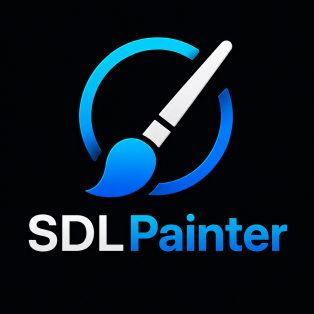
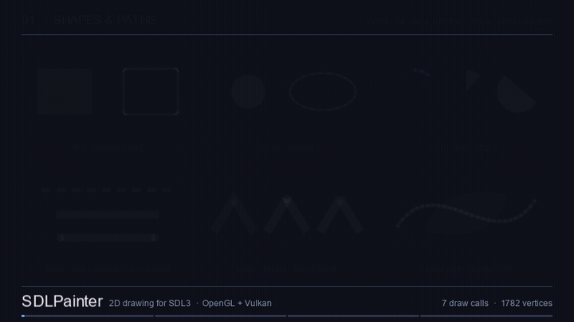
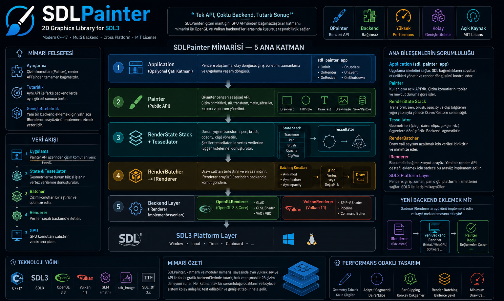

**Türkçe** | [English](README.md)

<div align="center">
  
  <h1>SDLPainter</h1>
  <p><strong>SDL3 + OpenGL/Vulkan dual backend destekli modern C++ 2B çizim kütüphanesi.</strong></p>
  <p>
    <a href="https://github.com/yazilimperver/sdl-painter/actions/workflows/ci.yml"></a>
    <a href="https://gitlab.com/yazilimperver/sdl-painter/-/pipelines"></a>
    <a href="https://yazilimperver.github.io/sdl-painter/coverage/"></a>
    <a href="https://github.com/yazilimperver/sdl-painter/releases/latest"></a>
    <a href="https://yazilimperver.github.io/sdl-painter"></a>
    <a href="LICENSE"></a>
  </p>
  <p>
    
    
    
    
  </p>
</div>



<div align="center">
  <sub>
    SDLPainter'ın maharetlerni gösteren uygulamamız: şekiller ve Bézier yolları ·
    gradient ve karıştırma modları · transform, kırpma ve viewport · doku,
    çizim hedefi ve metin. Alttaki sayaç canlı <code>FrameStats</code>.
    Kaynak: <a href="examples/hero.cpp"><code>examples/hero.cpp</code></a>
  </sub>
</div>

> SDLPainter bağımsız bir topluluk projesidir; SDL ekibiyle bir ilişkisi yoktur ve SDL ekibi tarafından onaylanmamıştır.

## Neden SDLPainter?

SDL3 size pencereyi, girdiyi ve üçgen seviyesinde yetenekli bir renderer'ı
verir. SDLPainter bunun üzerine bir katman ekler, kalın çizgi geometrisi,
poligon triangulation'ı, adaptif tessellation, transform stack ve batching,
böylece vertex yerine **şekil** düşünebilirsiniz.

- **Tek API, iki backend**, Aynı çizim kodu OpenGL 3.3 ve Vulkan 1.1'de
  çalışır; backend değiştirmek tek satır. Bir parite testi aynı sahneyi iki
  backend'de çizim hedefine çizip pikselleri karşılaştırır; gerçek sürücülerde
  sonuç bayt bayt aynıdır. Tek özellik farkı: 4× MSAA yalnızca OpenGL'de.
- **Doğru geometri**, Kalın çizgiler `glLineWidth` yerine quad tabanlı
  (platformlar arası tutarlı), konkav çokgenler "ear clipping" ile doğru
  dolduruluyor, daire segment sayısı yarıçapa göre uyarlanabiliyor.
- **Draw call'ları biriktirir**, `RenderBatcher` aynı mod/texture/opacity'deki
  çizimleri birleştirir; binlerce küçük şekili çizmek daha maliyet etkin olur.
- **İsteğe bağlı uygulama çatısı**, `sdl_painter_app` ile pencere, olay döngüsü
  ve zamanlamaya yönelik hazır bir takım altyapılar sunulmakta; istenirse kullanılabilir.
- **Tanıdık API**, QT ya da QPainter kullandıysanız çoğu API sizlere tanıdık gelecektir. Kullanmadıysanız da isimlendirmeler sizlere bir fikir verecektir (elbette API dokümantasyonu da mevcut):
  `DrawRect`, `FillCircle`, `Save`/`Restore`.

## Özellikler

| Alan | Desteklenen |
|------|-------------|
| **Primitifler** | Dikdörtgen, yuvarlatılmış dikdörtgen, daire, elips, dilim, kiriş ve çokgen stroke + fill; çizgi, polyline ve yay yalnızca stroke (yayın alanı dilim veya kirişle doldurulur) |
| **Stiller** | Pen (renk, kalınlık, outline, kesik deseni, uç ve birleşim stili), Brush (düz dolgu veya iki uçlu doğrusal/ışınsal gradient), global opacity, karıştırma modları |
| **Yol (Path)** | Doğru parçaları ve quadratic/cubic Bézier'lerden oluşan `Path`; kalemin tüm stilleriyle çizilir veya alt yol başına doldurulur (even-odd/nonzero dolgu kuralı yok, bu yüzden delik açılamaz) |
| **Transform** | `Translate` / `Rotate` / `Scale`, `Save`/`Restore` |
| **Clipping** | Scissor tabanlı dikdörtgen kırpma |
| **Çizim hedefi** | Ekran yerine dokuya çizim, mini harita, son işlem efektleri, iz efekti, ve pikselleri geri okuma |
| **Kenar yumuşatma** | 4× MSAA, **yalnızca OpenGL** ve yalnızca `Application` üzerinden (bir GL pencere özniteliği). Vulkan backend'i ve tüm çizim hedefleri tek örneklemli |
| **Viewport** | Alt dikdörtgene yerel koordinatlarla çizim, bölünmüş ekran, mini harita |
| **Image** | PNG / JPG yükleme (stb_image), kaynak→hedef ölçekleme, atlas dilimleme, tint, aynalama, nearest/linear filtre, yerinde doku güncelleme, serbest dokulu ızgara |
| **Metin** | SDL_ttf 3.x, glyph cache, left/center/right hizalama, çok satırlı ve sözcük kaydırmalı, fontun `kern` tablosundan kerning. Yalnızca soldan sağa: ligatür, çift yönlü metin ve karmaşık yazım biçimlendirmesi yok |
| **Backend** | OpenGL 3.3 Core ve Vulkan 1.1, `IRenderer` ile değiştirilebilir. Süreç başına aynı anda tek `Painter`; çoklu GL context desteklenmiyor |

## Blog Yazıları

Aşağıdaki bağlantıda [Yazilimperver](https://www.yazilimperver.net) sayfamda, bu kütüphane ile ilgili yayınlamış olduğum yazıları bulabilirsiniz:

- [SDLPainter - Core Primitives and Capabilities](https://yazilimperver.net/index.php/2026/08/29/sdl-painter-temel-sekiller-ve-kabiliyetler-faz-1/)

- [SDLPainter - Proje CI/CD Altyapıs](https://yazilimperver.net/index.php/2026/08/04/sdl-painter-proje-altyapisi-devam-faz-0-ci-cd/)

- [SDLPainter - Kütüphane Dokümantasyon Mekanizması](https://yazilimperver.net/index.php/2026/07/06/sdl-painter-dokumantasyon/)

- [SDLPainter - Proje Altyapısı](https://yazilimperver.net/index.php/2026/07/03/sdl-painter-proje-altyapisi-faz-0/)

- [SDLPainter - Proje Duyurusu](https://yazilimperver.net/index.php/2026/05/18/duyuru-sdl-painter/)

- [SDL3 ve Conan](https://yazilimperver.net/index.php/2026/03/28/arac-sdl3-ve-conan/)

- [SDL3 CI/CD](https://yazilimperver.net/index.php/2025/08/23/arac-sdl3-ci-cd/)

- [SDL3 Birim Testler – II](https://yazilimperver.net/index.php/2025/07/27/arac-sdl3-birim-testler-ii/)

- [SDL3 Birim Testler](https://yazilimperver.net/index.php/2025/07/13/arac-sdl3-birim-testler/)

- [SDL3 İlk Adımlar – II](https://yazilimperver.net/index.php/2025/06/24/arac-sdl3-ilk-adimlar-ii/)

- [SDL3 İlk Adımlar – I](https://yazilimperver.net/index.php/2025/06/09/arac-sdl3-ilk-adimlar-i/)

- [Hello SDL3](https://yazilimperver.net/index.php/2025/05/25/arac-merhaba-sdl3/)

Aşağıdaki yazılar ise SDL2 ile olan yazılar:

- [Android – SDL 2.0.8 Güncellemesi](https://yazilimperver.net/index.php/2018/09/13/android-sdk-2-0-8-guncellemesi/)

- [VS 2017 ile C/C++ Kütüphanelerin (SDL) Android için Oluşturulması](https://yazilimperver.net/index.php/2018/01/06/visual-studio-2017-ile-ucuncu-parti-cc-kutuphanelerin-sdl-android-icin-olusturulmasi/)

- [uEngine4 Serüveni – Giriş (Painter Sınıfları)](https://yazilimperver.net/index.php/2023/06/07/uengine4-seruveni-giris-painter-siniflari/)

- [uEngine4 Serüveni – BasicGLPainter – I](https://yazilimperver.net/index.php/2023/09/10/uengine4-seruveni-basicglpainter-i/)

- [uEngine4 Serüveni – BasicGLPainter – II](https://yazilimperver.net/index.php/2023/10/15/uengine4-seruveni-basicglpainter-ii/)


## Kurulum

### CMake, `find_package`

SDLPainter'ı bir kez derleyip kurun ([Hızlı Başlangıç](doc/hizli-baslangic.md)),
sonra:

```cmake
find_package(sdl_painter CONFIG REQUIRED)

target_link_libraries(my_app PRIVATE sdl_painter::sdl_painter)
```

CMake'i kurulum dizinine `-DCMAKE_PREFIX_PATH=/kurulum/yolu` ile yönlendirin.

### CMake, `FetchContent`

```cmake
include(FetchContent)

# Aşağıdaki sürümü güncel sürüm ile değiştirebilirsiniz
FetchContent_Declare(sdl_painter
    GIT_REPOSITORY https://github.com/yazilimperver/sdl-painter.git
    GIT_TAG        v1.4.0)

# Demoları ve birim testleri kendi projenizin parçası olarak derlemeyin.
set(SDLPAINTER_BUILD_EXAMPLES OFF)
set(SDLPAINTER_BUILD_TESTS    OFF)

FetchContent_MakeAvailable(sdl_painter)

target_link_libraries(my_app PRIVATE sdl_painter::sdl_painter)
```

FetchContent SDLPainter'ı projenizin içinde derler; bu yüzden bağımlılıkları
(SDL3, SDL3_ttf, glm, glad, stb, spdlog) `find_package` ile bulunabilir olmalı.
Bunları sağlamanın en kolay yolu Conan, bkz.
[Hızlı Başlangıç](doc/hizli-baslangic.md).

Vulkan backend'i **varsayılan olarak kapalıdır**. `-DSDLPAINTER_WITH_VULKAN=ON`
ile (ya da `FetchContent_MakeAvailable`'dan önce `set(SDLPAINTER_WITH_VULKAN ON)`
ile) açılır; bu durumda Vulkan loader ve başlıkları da gerekir.

Her iki yol da **aynı hedef isimlerini** sunar; target'lar birbirinin yerine
kullanılabilir. Opsiyonel pencere / olay döngüsü / zamanlama katmanı ayrı bir
hedef olarak sunulur ([ADR-008](adr/ADR-008-application-framework-layer.md)):

```cmake
target_link_libraries(my_app PRIVATE sdl_painter::app)
```

**Windows'ta** SDL3 ve bağımlılıkları shared kütüphane olarak sunulmakta; executable'ınızın
yanında olmazlarsa program `0xC0000135` ile kapanabilir, bkz.
[Çalışma zamanı DLL'leri](doc/en/building.md#deploying-runtime-dlls-windows)
*(İngilizce)*. Reponun kendi örnekleri ve testleri bu DLL'leri otomatik
kopyalar; kendi uygulamanızda bir kopyalama adımı gerekir. Bağlantıdaki bölüm
tek satırlık CMake kuralını ve metin çizimi için ek gereken DLL'leri anlatır.

### Conan

Conan Center recipe'i incelemede
([conan-center-index#31238](https://github.com/conan-io/conan-center-index/pull/31238)).
Birleşene kadar paketi sürüm etiketinden yerel Conan önbelleğinize
oluşturabilirsiniz:

```bash
git clone --branch v1.4.0 https://github.com/yazilimperver/sdl-painter.git
conan create sdl-painter --build=missing -o "sdl_painter/*:build_tests=False" -o "sdl_painter/*:build_examples=False"
```

Profiliniz daha eski bir standart kullanıyorsa `-s compiler.cppstd=17` ekleyin
(MSVC için algılanan profil varsayılan olarak C++14 kullanır); Vulkan backend'i
için `-o "sdl_painter/*:with_vulkan=True"`. Ardından projenizde
`sdl_painter/1.4.0`'ı kullanabilirsiniz; CMake hedefleri yukarıdakilerle aynıdır.

## Kısa örnek

```cpp
sdl_painter::Painter painter(window, sdl_painter::RendererBackend::kOpenGL);

painter.Begin();
painter.Clear({30, 30, 30, 255});

painter.SetPen(sdl_painter::Pen({255, 0, 0, 255}, 2.0f));
painter.SetBrush(sdl_painter::Brush({100, 100, 255, 128}));
painter.DrawCircle(400, 300, 80);

painter.Save();
painter.Translate(400, 300);
painter.Rotate(45.0f);
painter.DrawRect(-50, -50, 100, 100);
painter.Restore();

painter.End();
```

Reponun kendisini derleyip ilk demoyu çalıştırmak için:

```bash
conan install . --output-folder=build/linux-debug/generators --build=missing -s build_type=Debug
cmake --preset linux-debug && cmake --build --preset linux-debug
./build/linux-debug/examples/primitives
```

Ayrıntılı anlatım: [Hızlı Başlangıç Rehberi](doc/hizli-baslangic.md).

Diğer örnekler için **[Examples](examples/README.md)**'e başvurabilirsiniz. 

### SDL_Renderer ile ilişkisi

Çoğu zaman SDL3'ün kendi `SDL_Renderer`'ı yeterlidir: ek bağımlılık istemez,
backend'i platforma göre kendisi seçer ve `SDL_RenderGeometry` ile istediğiniz
üçgenleri çizer. SDLPainter ise elle yazacağınız şekil seviyesindeki işi
üstlenir:

| İhtiyaç | Elle yazınca | SDLPainter ile |
|---|---|---|
| 3 px kalınlığında çizgi | Normal vektör hesapla, quad kur, 2 üçgen üret | `SetPen(Pen(color, 3.0F)); DrawLine(...)` |
| Konkav poligon doldur | Triangle fan yetmez → ear clipping yaz | `FillPolygon(points)` |
| Yarıçapa göre pürüzsüz daire | Segment sayısını elle ayarla, fan kur | `FillCircle(cx, cy, r)`, segment adaptif |
| Döndürülmüş bir grup şekil | Vertex'leri elle çarp | `Save(); Rotate(45); …; Restore()` |
| 5.000 küçük şekil | Elle grupla, draw call'ları birleştir | `RenderBatcher` otomatik yapar |

SDLPainter'da backend'i siz seçersiniz (OpenGL 3.3 ya da Vulkan 1.1) ve
`IRenderer`'ı uygulayarak yenisini ekleyebilirsiniz. Bunun bir bedeli de var elbet:
`SDL_Renderer` Direct3D ve Metal'i de destekler, SDLPainter desteklemez.

### SDL_GPU ve NanoVG

- **SDL_GPU**, SDL3'ün daha alt seviyedeki GPU API'si, şu an kullanılmıyor;
  SDLPainter'ın backend'leri OpenGL 3.3 ve Vulkan 1.1.
- **NanoVG** en yakın alternatif ve vektör tarafında önde: delikli yollar,
  yerleşik kenar yumuşatma (anti-aliasing), çok küçük bir kod tabanı ve daha
  uzun bir geçmiş. Bunlara ihtiyacınız varsa NanoVG'yi seçin; SDL3
  uygulamanızda tip güvenli bir C++17 çizim katmanı, Vulkan seçeneği ve
  CMake/Conan paketi istiyorsanız SDLPainter'ı.

### Size uygun mu?

**Uygunsa, eğer**

- SDL3 uygulaması yazıyor ve üçgen değil şekil çizmek istiyorsanız
- araç ve editör, görselleştirme, simülasyon ya da 2B oyun geliştiriyorsanız
- kalın çizgi, konkav poligon ya da dönüşümleri geometriyi kendiniz yazmadan
  istiyorsanız
- aynı çizim kodunun OpenGL'de ve Vulkan'da çalışmasını istiyorsanız
- kopyalanacak bir dosya yerine CMake ya da Conan ile kurulan bir kütüphane
  istiyorsanız

**Başka yere bakın, eğer**

- delikli yollar, çok duraklı gradient ya da yüksek kaliteli kenar yumuşatma
  gerekiyorsa → [NanoVG](https://github.com/memononen/nanovg) ya da
  [Blend2D](https://blend2d.com/)
- ek bağımlılık olmadan en basit çözüm yetiyorsa → SDL3'ün `SDL_Renderer`'ı
- Direct3D ya da Metal backend'i, macOS veya Android gerekiyorsa →
  desteklenmiyor
- her biri kendi Painter'ına sahip birden çok pencere gerekiyorsa → bugün süreç
  başına tek `Painter`
- oyun motoru, UI çatısı, 3B renderer ya da sahne grafiği arıyorsanız →
  SDLPainter bunların hiçbiri değil


## Mimari

Mimari temel olarak beş katman üzerine kurulu, her biri tek bir sorumluluğa odaklı:

1. **Application** *(opsiyonel)*, pencere, olay döngüsü, zamanlama gibi işler ([ADR-008](adr/ADR-008-application-framework-layer.md))
2. **Painter**, public API; çizim komutlarını toplar, güncel state'i uygular
3. **RenderState + Tessellator**, transform/pen/brush/opacity/clip yığını; şekilleri vertex'e çevirir. Transform 3×3 affine `glm::mat3`, column-major ([ADR-007](adr/ADR-007-glm-transform-matrix.md))
4. **RenderBatcher → IRenderer**, draw call'ları birleştirip backend'e iletir
5. **Backend**, `OpenGLRenderer` / `VulkanRenderer`, SDL3 platform katmanı üzerinde

Yeni bir backend eklemek yalnızca `IRenderer`'ı implemente etmeyi gerektirir;
Painter kodu değişmez. Bu katmanları şekillendiren her karar bir
[Mimari Karar Kaydı](adr/README.md) olarak tutuluyor.




## Desteklenen platformlar

| Platform | Araç zinciri | OpenGL | Vulkan |
|---|---|:---:|:---:|
| Linux | GCC / Clang | ✅ | ✅ |
| Windows | MSVC (VS 2022) | ✅ | ✅ |
| Windows | Linux'ta MinGW cross-compile | ✅ | ❌ |
| macOS |, | ❌ | ❌ |
| Android |, | ❌ | ❌ |


## Dokümantasyon

| | |
|---|---|
| [API referansı (Doxygen)](https://yazilimperver.github.io/sdl-painter) | Public header'lardan üretiliyor, her `main` push'unda güncelleniyor |
| [Hızlı Başlangıç](doc/hizli-baslangic.md) | Kurulum, preset'ler, CMake seçenekleri, sorun giderme |
| [Örnekler Rehberi](doc/ornekler.md) | Her demonun ne gösterdiği |
| [Mimari Karar Kayıtları](adr/README.md) | Tasarımın neden böyle olduğu |
| [Genel bakış infografiği](doc/images/tr/general-overview.png) | Kütüphanenin tek sayfalık görsel özeti |
| [Mimari Genel Bakış](doc/mimari-genel-bakis.md) | Katmanlar, bağımlılıklar, veri akışı, değişmezler |
| [Derleme](doc/en/building.md) · [Script'ler](doc/en/scripts.md) · [Geliştirme](doc/en/development.md) | Önkoşullar, Docker, script referansı, kalite kontrolleri, CI/CD *(İngilizce)* |

Diğer tasarım dokümanları:
[Özellik Listesi](doc/ozellikler.md) ·
[Sınıf Diyagramları](doc/sinif-diyagrami.md) ·
[Akış Diyagramları](doc/akislar.md) ·
[Backend İç Yapısı](doc/backend-ic-yapisi.md) ·
[Yazılım Mühendisliği](doc/yazilim-muhendisligi.md) ·
[Dokümantasyon Rehberi](doc/dokumantasyon-rehberi.md) ·
[Docker Rehberi](doc/docker.md) ·
[Docker Hub'a Yayınlama](doc/docker-hub-deployment.md)

## Katkı

Issue ve pull request'ler açıktır, commit formatı, branch stratejisi ve ADR'nin
ne zaman zorunlu olduğu için [CONTRIBUTING.md](CONTRIBUTING.md). Format kontrolü
CI'da zorunlu; push'tan önce `./scripts/format-check.sh --fix` çalıştırın.

Değişiklikler [CHANGELOG.md](CHANGELOG.md) içinde izleniyor.

## Lisans

MIT, bkz. [LICENSE](LICENSE).
