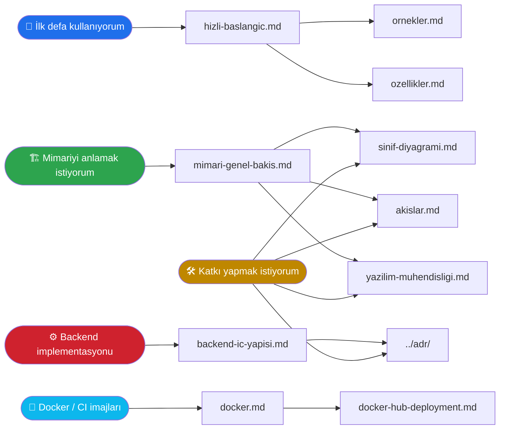

**Türkçe** | [English version](en/README.md)

# SDLPainter — Dokümantasyon

SDL3 + OpenGL/Vulkan dual backend destekli C++ 2B çizim kütüphanesinin teknik dokümantasyonu.
Dokümanların İngilizce sürümleri [en/](en/README.md) dizinindedir.

---

## 📚 Doküman Haritası

---

## 📖 Dokümanlar

### Başlangıç

| Doküman | İçerik |
|---------|--------|
| [Hızlı Başlangıç](hizli-baslangic.md) · [Getting Started](en/getting-started.md) | Önkoşullar, kurulum, ilk uygulama, sık sorunlar |
| [Özellik Listesi](ozellikler.md) · [Features](en/features.md) | Desteklenen primitifler, stiller, backend'ler |
| [Örnekler](ornekler.md) · [Examples Guide](en/examples-guide.md) · [examples/README.md](../examples/README.md) | Kullanım örnekleri ve kod parçaları |
| [Building](en/building.md) · [Scripts](en/scripts.md) · [Development](en/development.md) | Derleme, Docker, script referansı, kalite kontrolleri, CI/CD *(İngilizce)* |

### Mimari

| Doküman | İçerik |
|---------|--------|
| [Mimari Genel Bakış](mimari-genel-bakis.md) · [Architecture](en/architecture.md) | Katmanlar, bileşen bağımlılıkları, kaynak ağacı, sözleşmeler |
| [Sınıf Diyagramı](sinif-diyagrami.md) · [Class Diagram](en/class-diagram.md) | UML class diagram (Mermaid) — Painter, render hattı, görseller, backend'ler |
| [Akış Diyagramları](akislar.md) · [Flows](en/flows.md) | Frame yaşam döngüsü, draw call, batch flush, transform stack, texture upload, Vulkan frame |
| [Yazılım Mühendisliği Perspektifi](yazilim-muhendisligi.md) · [Software Engineering](en/software-engineering.md) | Tasarım kararlarının gerekçeleri, SOLID, kapsam yönetimi |

### Backend Detayı

| Doküman | İçerik |
|---------|--------|
| [Backend İç Yapısı](backend-ic-yapisi.md) · [Backend Internals](en/backend-internals.md) | OpenGL 3.3 ve Vulkan 1.1 implementasyonu, karşılaştırma, yeni backend ekleme |

### Docker ve Dağıtım

| Doküman | İçerik |
|---------|--------|
| [Docker Kullanım Kılavuzu](docker.md) · [Docker Guide](en/docker.md) | İmaj hiyerarşisi, builder/ci/windows-cross aşamaları, GitLab CI entegrasyonu, Dockerfile.windows |
| [Docker Hub'a Dağıtım](docker-hub-deployment.md) · [Publishing to Docker Hub](en/docker-hub-deployment.md) | İmaj build, etiketleme, Hub/GitLab Registry'ye push, otomatik CI/CD akışı |

### Katkı ve Dokümantasyon

| Doküman | İçerik |
|---------|--------|
| [Dokümantasyon Rehberi](dokumantasyon-rehberi.md) · [Documentation Guide](en/documentation-guide.md) | Doxygen yorum standardı, etiket kullanımı, yerel build, GitLab Pages |

### Karar Kayıtları

| Doküman | İçerik |
|---------|--------|
| [ADR Dizini](../adr/) | Architecture Decision Records — neden böyle yapıldı? |

---

## 🎯 Sık Sorulan Sorular

**1. QPainter biliyorum, SDLPainter'a nasıl geçerim?**
→ [Hızlı Başlangıç](hizli-baslangic.md). API büyük ölçüde aynı; `Save`/`Restore`,
`SetPen`/`SetBrush`, `DrawRect`/`FillRect` semantik olarak özdeş.

**2. OpenGL ve Vulkan arasındaki fark kullanıcı tarafından hissedilir mi?**
→ Hayır. Tek değişiklik constructor argümanı (`RendererBackend::kVulkan`).
Tüm Painter API çağrıları aynı şekilde çalışır. Detay:
[backend-ic-yapisi.md → §4](backend-ic-yapisi.md#4-i̇ki-backendin-aynı-painter-çağrısına-verdiği-yanıt).

**3. Yeni bir backend eklemek istiyorum (örn. DirectX, Metal).**
→ Sadece `IRenderer` arayüzünü implemente etmek yeterli. Elbette böyle bir yola girecekseniz beni de bir dürterseniz sevinirim :)

 Detay:
[backend-ic-yapisi.md → §5](backend-ic-yapisi.md#5-backend-eklemek).

**4. Performans nasıl?**
→ `RenderBatcher` aynı state ile gelen draw call'ları **tek bir GPU
çağrısına** birleştirir. 100 aynı renkli `FillRect` = 1 draw call.

**TODO**: Buna yönelik detaylı bir test ve çıktısını ekleyelim.

Detay: [akislar.md → §3](akislar.md#3-render-batcher-akışı).

**5. Path / Bezier / Gradient destekleniyor mu?**
→ Evet. `Path` doğru parçaları ve quadratic/cubic Bézier taşır (`DrawPath` /
`FillPath`); `Brush::LinearGradient` ve `Brush::RadialGradient` iki duraklı
geçiş verir. **Sınırlar:** delikli dolgu (even-odd / nonzero) ve çok duraklı /
conical gradient yok. Gerekçeler:
[yazilim-muhendisligi.md → Kapsam Yönetimi](yazilim-muhendisligi.md#kapsam-yönetimi).

---

## 🔗 İlgili Kaynaklar

- **Repo kök dosyaları:** `CMakeLists.txt`, `conanfile.py`, `CMakePresets.json`
- **CI/CD:** `.gitlab-ci.yml`
- **Proje kuralları:** `.claude/CLAUDE.md`, `.claude/rules/*.md`
- **ADR'ler:** `adr/` dizini
- **Demo kodları:** `examples/*.cpp` (bkz. [examples/README.md](../examples/README.md))
- **Birim testler:** `tests/test_*.cpp`

---

## 📐 Diyagram Notasyonu

Tüm diyagramlar **Mermaid** formatındadır:

- ✅ GitHub, GitLab, MkDocs, Obsidian, IntelliJ, VS Code (eklenti) doğrudan render eder
- ✅ Versiyonlanabilir (markdown içinde düz metin)
- ✅ Diff'lenebilir (PR review'da değişiklik görülür)
- ❌ PNG/SVG'ye gerek yok; gerekirse Mermaid CLI ile dışa aktarılabilir

Sınıf diyagramlarında ilişki sembollerinin anlamı için
[sinif-diyagrami.md → §7](sinif-diyagrami.md#7-i̇lişki-türleri-sözlüğü).
