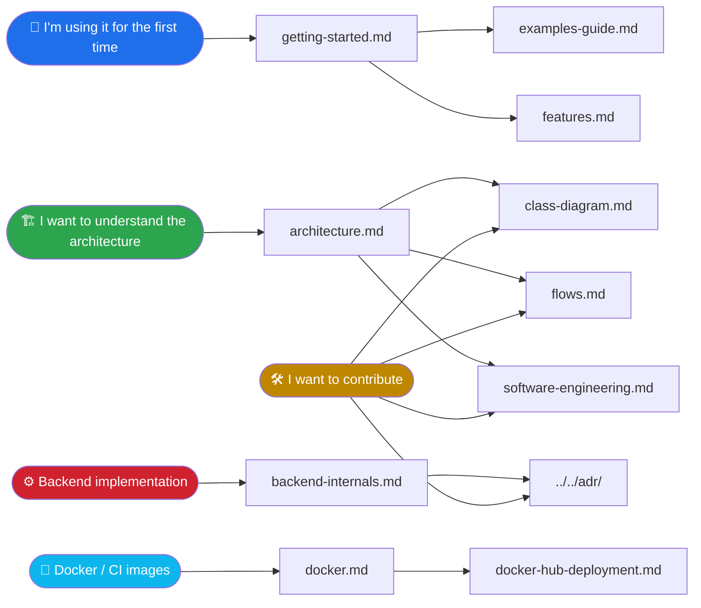

[Türkçe sürüm](../README.md) | **English**

# SDLPainter — Documentation

Technical documentation of the C++ 2D drawing library with an SDL3 + OpenGL/Vulkan
dual backend. The documents were originally written in Turkish; this directory
holds their English versions.

---

## 📚 Document Map

---

## 📖 Documents

### Getting Started

| Document | Contents |
|---------|--------|
| [Getting Started](getting-started.md) | Prerequisites, setup, first application, common problems |
| [Feature List](features.md) | Supported primitives, styles, backends |
| [Examples Guide](examples-guide.md) · [examples/README.md](../../examples/README.md) | Usage examples and code snippets |
| [Building](building.md) · [Scripts](scripts.md) · [Development](development.md) | Building, Docker, script reference, quality checks, CI/CD |

### Architecture

| Document | Contents |
|---------|--------|
| [Architecture Overview](architecture.md) | Layers, component dependencies, source tree, contracts |
| [Class Diagram](class-diagram.md) | UML class diagram (Mermaid) — Painter, render pipeline, images, backends |
| [Flow Diagrams](flows.md) | Frame lifecycle, draw call, batch flush, transform stack, texture upload, Vulkan frame |
| [Software Engineering Perspective](software-engineering.md) | Rationale behind the design decisions, SOLID, scope management |

### Backend Detail

| Document | Contents |
|---------|--------|
| [Backend Internals](backend-internals.md) | OpenGL 3.3 and Vulkan 1.1 implementation, comparison, adding a new backend |

### Docker and Distribution

| Document | Contents |
|---------|--------|
| [Docker User Guide](docker.md) | Image hierarchy, builder/ci/windows-cross stages, GitLab CI integration, Dockerfile.windows |
| [Publishing to Docker Hub](docker-hub-deployment.md) | Image build, tagging, pushing to Hub/GitLab Registry, automated CI/CD flow |

### Contributing and Documentation

| Document | Contents |
|---------|--------|
| [Documentation Guide](documentation-guide.md) | Doxygen comment standard, tag usage, local build, GitLab Pages |

### Decision Records

| Document | Contents |
|---------|--------|
| [ADR Index](../../adr/) | Architecture Decision Records — why was it done this way? *(the records are in Turkish)* |

---

## 🎯 Frequently Asked Questions

**1. I know QPainter, how do I switch to SDLPainter?**
→ [Getting Started](getting-started.md). The API is largely the same; `Save`/`Restore`,
`SetPen`/`SetBrush`, `DrawRect`/`FillRect` are semantically identical.

**2. Does the user notice any difference between OpenGL and Vulkan?**
→ No. The only change is the constructor argument (`RendererBackend::kVulkan`).
All Painter API calls work the same way. Details:
[backend-internals.md → §4](backend-internals.md#4-how-the-two-backends-respond-to-the-same-painter-call).

**3. I want to add a new backend (e.g. DirectX, Metal).**
→ Implementing the `IRenderer` interface is all it takes. Of course, if you set out on that road, I'd be glad if you gave me a nudge too :)

 Details:
[backend-internals.md → §5](backend-internals.md#5-adding-a-backend).

**4. How is the performance?**
→ `RenderBatcher` merges draw calls that arrive with the same state into **a
single GPU call**. 100 `FillRect`s of the same color = 1 draw call.

**TODO**: Let's add a detailed test for this along with its output.

Details: [flows.md → §3](flows.md#3-render-batcher-flow).

**5. Are Path / Bezier / Gradient supported?**
→ Yes. `Path` carries line segments and quadratic/cubic Bézier curves (`DrawPath` /
`FillPath`); `Brush::LinearGradient` and `Brush::RadialGradient` give a two-stop
transition. **Limits:** no fills with holes (even-odd / nonzero) and no
multi-stop / conical gradients. Rationale:
[software-engineering.md → Scope Management](software-engineering.md#scope-management).

---

## 🔗 Related Resources

- **Repo root files:** `CMakeLists.txt`, `conanfile.py`, `CMakePresets.json`
- **CI/CD:** `.gitlab-ci.yml`
- **Project rules:** `.claude/CLAUDE.md`, `.claude/rules/*.md`
- **ADRs:** the `adr/` directory
- **Demo code:** `examples/*.cpp` (see [examples/README.md](../../examples/README.md))
- **Unit tests:** `tests/test_*.cpp`

---

## 📐 Diagram Notation

All diagrams are in **Mermaid** format:

- ✅ GitHub, GitLab, MkDocs, Obsidian, IntelliJ, VS Code (extension) render it directly
- ✅ Versionable (plain text inside markdown)
- ✅ Diffable (changes are visible in PR review)
- ❌ No need for PNG/SVG; can be exported with the Mermaid CLI if needed

For the meaning of the relationship symbols in class diagrams see
[class-diagram.md → §7](class-diagram.md#7-relationship-types-glossary).
