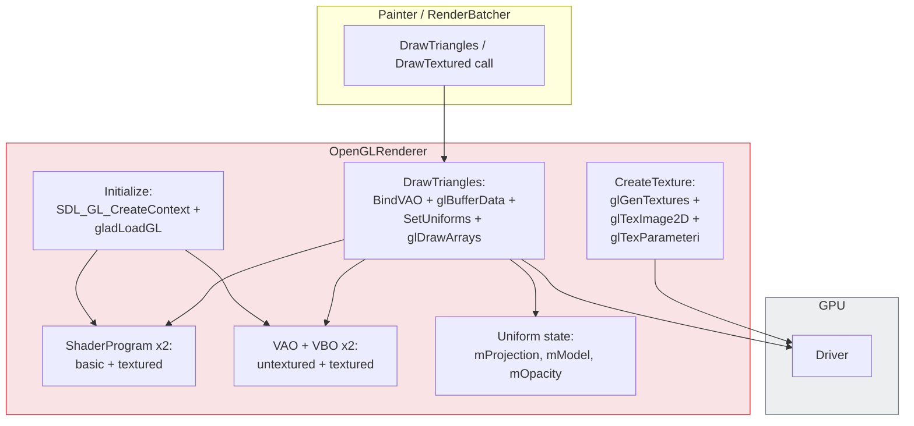
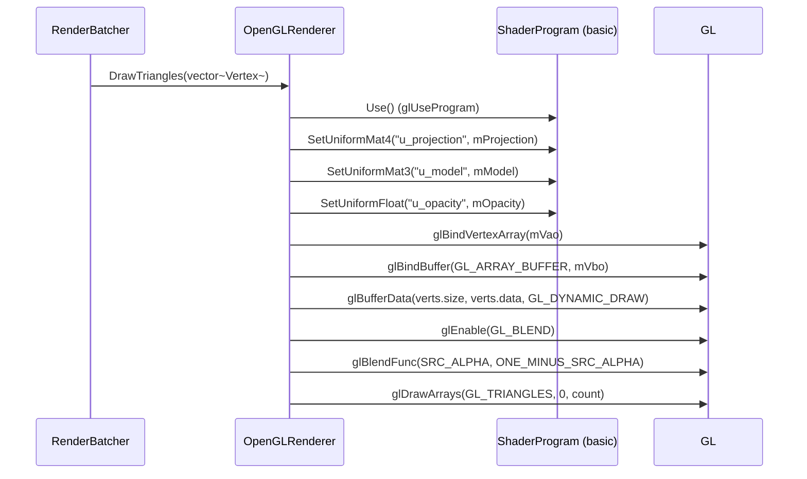
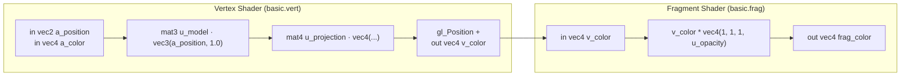
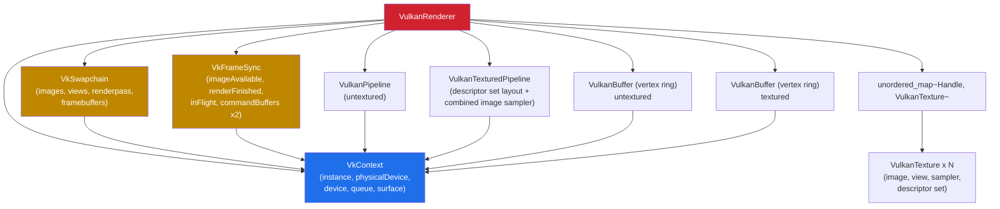
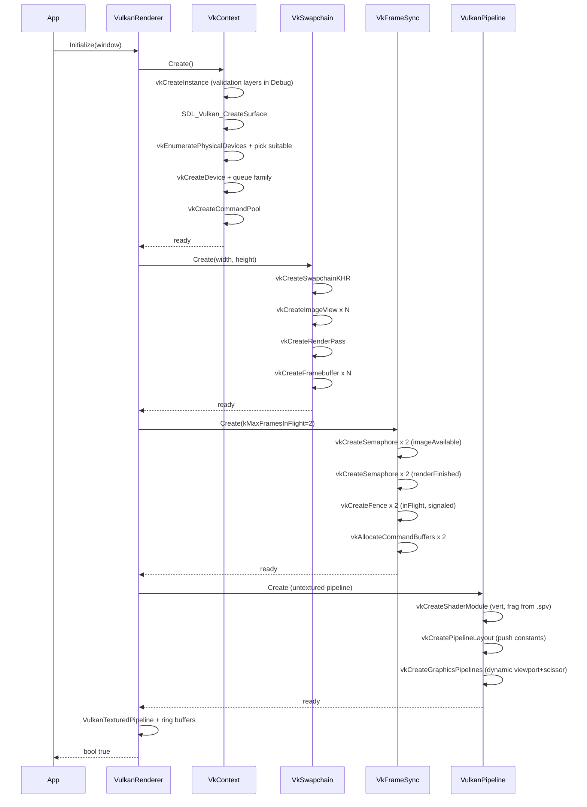
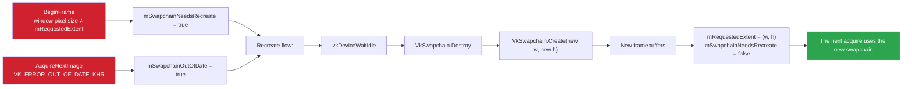
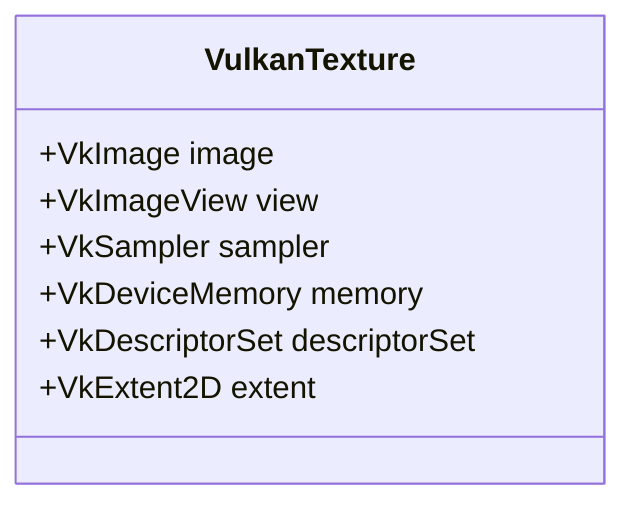
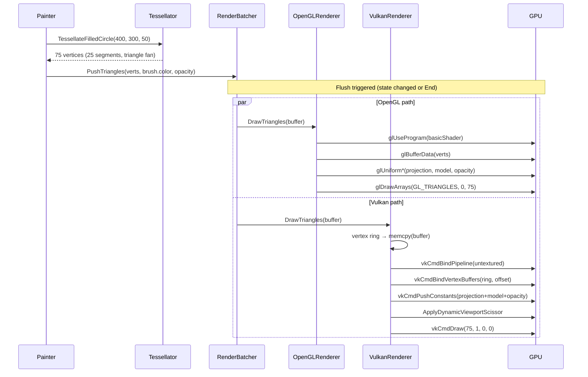
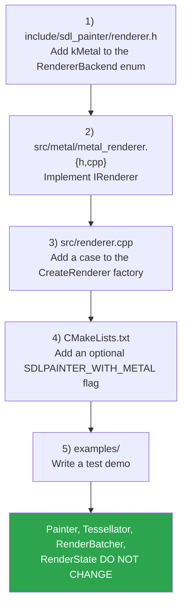

[Türkçe sürüm](../backend-ic-yapisi.md) | **English**

# SDLPainter — Backend Internals

In this document I will try to describe in detail the **two concrete
implementations** behind the `IRenderer` interface (OpenGL 3.3 and Vulkan 1.1).
For the upper-layer context see the [Architecture Overview](architecture.md);
for the interface definitions see the [Class Diagram](class-diagram.md).

---

## 1. Backend Comparison

| Topic | OpenGL 3.3 Backend | Vulkan 1.1 Backend |
|------|-------------------|-------------------|
| Initialization complexity | Low (context + GLAD) | High (instance/device/swapchain/sync) |
| Frame structure | Begin/End trivial | Begin/End: acquire + submit + present |
| Command submission | Immediate | Recorded into a command buffer |
| Vertex upload | `glBufferData` on every draw | Ring buffer + persistent map |
| Shader | GLSL 330 source embedded in the binary, compiled at runtime | SPIR-V embedded in the binary (pre-built offline with `glslc`) |
| Uniform | `glUniform*` | Push constants |
| Window size | Automatic | Requires swapchain recreate |
| Sync | Left to the driver | Manual (semaphore + fence) |
| Texture | `glGenTextures` + bind | `VkImage` + `VkImageView` + sampler + descriptor |
| Required SDL flag | `SDL_WINDOW_OPENGL` | `SDL_WINDOW_VULKAN` |

**Summary:** The OpenGL backend gives a simple, quick start. The Vulkan backend
works more efficiently with modern GPU architectures and gives more control; in
return it requires far more code and care. Since both use the same `IRenderer`
interface, Painter sees no difference between them.

---

## 2. OpenGL 3.3 Backend

### 2.1 Component Structure



### 2.2 Draw Flow (`DrawTriangles`)



### 2.3 Shader Programs

There are two separate programs:

- **basic** — `basic.vert` + `basic.frag`: position + per-vertex color
- **textured** — `textured.vert` + `textured.frag`: position + UV + per-vertex tint



> Because color is carried in the vertex, triangles of different colors can be
> drawn in **a single draw call** even across different pens/brushes. This is one
> of the cornerstones of RenderBatcher's efficiency.
>
> The same holds for the transform. `u_model` is still in the shader, but
> `Painter` always sends it as **identity**; the transform is applied on the CPU
> inside `RenderBatcher::PushTriangles`, in the same copy loop that writes the
> color. So `Translate`/`Rotate`/`Scale` do not break the batch either.
> Measurement: with 2000 shapes and a transform per shape we saw
> **2000 → 2 draw calls**, 9.44 ms → 0.30 ms.
> For detailed results and examples: [`examples/benchmarks/README.md`](../../examples/benchmarks/README.md).

### 2.4 Texture Operations

```cpp
// CreateTexture in outline
glGenTextures(1, &id);
glBindTexture(GL_TEXTURE_2D, id);
glTexImage2D(GL_TEXTURE_2D, 0, format, w, h, 0, format, GL_UNSIGNED_BYTE, data);
glTexParameteri(GL_TEXTURE_2D, GL_TEXTURE_MIN_FILTER, GL_LINEAR);
glTexParameteri(GL_TEXTURE_2D, GL_TEXTURE_MAG_FILTER, GL_LINEAR);
glTexParameteri(GL_TEXTURE_2D, GL_TEXTURE_WRAP_S, GL_CLAMP_TO_EDGE);
glTexParameteri(GL_TEXTURE_2D, GL_TEXTURE_WRAP_T, GL_CLAMP_TO_EDGE);
return static_cast<TextureHandle>(id);   // GL ID = TextureHandle
```

In the OpenGL backend `TextureHandle` is the GL texture ID itself (`uint32_t`).
In the Vulkan backend it is an opaque number resolved through an internal map.

### 2.5 Y-Axis Conversion

In OpenGL window coordinates Y=0 is at the **bottom**; in the SDLPainter API
Y=0 is at the **top**. Painter builds the projection matrix accordingly
(`UpdateProjection`):

```
ortho(0, width, height, 0, -1, 1)   // top-left origin
```

For scissoring, however, **OpenGL wants its native Y** (from the bottom); that
is why `Painter::ApplyScissor` applies a flip:
```cpp
gl_y = viewport_height - rect.y - rect.h;
glScissor(rect.x, gl_y, rect.w, rect.h);
```

---

## 3. Vulkan 1.1 Backend

### 3.1 Component Hierarchy



### 3.2 Initialize Flow



### 3.3 Frame Flow

For details see [Flow Diagrams → Vulkan Frame](flows.md#7-vulkan-frame-flow-phase-5).
Three important details:

1. **2 frames in flight** — `kMaxFramesInFlight = 2`. While the CPU prepares one
   frame, the GPU draws the previous one.
2. **Vertex ring buffer** — `VulkanBuffer` is persistently mapped; on every
   `DrawTriangles` call the offset inside the ring advances, so memcpy + draw
   are atomic.
3. **Push constants** — The projection × model matrix, tint and opacity are sent
   as push constants; there is no descriptor set or UBO.

### 3.4 Push Constants Layout

```cpp
struct PushConstants {
  float transform[16];    // mat4: projection × model, multiplied on the CPU
  float tint_color[4];    // vec4
  float opacity;
};
```

84 bytes in total; below the 128 bytes Vulkan guarantees (guarded by a
`static_assert`). It can change on every draw call and needs no descriptor set
update.

### 3.5 Swapchain Recreate

The swapchain is rebuilt by two triggers:



The first trigger is the size check in `BeginFrame`. On surfaces that report a
`currentExtent` of 0xFFFFFFFF (Wayland, the headless surface of SDL's
`offscreen` driver) the swapchain determines the surface size; when the window
changes the swapchain does not become incompatible and the driver does not have
to report `OUT_OF_DATE`. That is why `BeginFrame` polls the window's pixel size
(`SDL_GetWindowSizeInPixels`) every frame and, if it differs, rebuilds the
swapchain before acquiring an image. The comparison is made against the size
requested at the last successful build (`mRequestedExtent`), not against the
swapchain extent: the extent may have been clamped by
`minImageExtent`/`maxImageExtent` or stayed at the size the surface reports,
and the swapchain would then be rebuilt every frame. `mRequestedExtent` is
updated in `Initialize` and on every successful rebuild along either path.

A rebuild moves the viewport to the new extent only if `SetViewport` has never
been called, so in that case the viewport tracks the surface. A viewport given
through `SetViewport` (`mViewportSetByCaller`) is preserved, just as OpenGL
writes `glViewport` only in `SetViewport`; on a size change Painter itself sends
the new viewport before `BeginFrame`.

The `QueuePresentKHR` call can also return `OUT_OF_DATE_KHR` or
`SUBOPTIMAL_KHR`; the same recreate path is triggered.

If the surface is not renderable (minimized, 0x0), `BeginFrame` skips the frame
before reaching the size check and sets `mSwapchainNeedsRecreate`; the rebuild
is deferred until the window comes back. If a rebuild fails, the flag stays set
and the next frame tries again.

### 3.6 Texture Lifecycle (Vulkan)

A single `VulkanTexture` wraps the following Vulkan objects:



Creation steps:

1. `vkCreateImage` (TILING_OPTIMAL)
2. `vkAllocateMemory` + `vkBindImageMemory`
3. Copy the pixel data through a **staging buffer**
4. `vkCmdCopyBufferToImage` (transfer command)
5. Layout transition: `UNDEFINED → TRANSFER_DST → SHADER_READ_ONLY`
6. `vkCreateImageView` (RGBA format)
7. `vkCreateSampler` (LINEAR + CLAMP_TO_EDGE)
8. Bind to the descriptor set: `combined image sampler`

Destruction: `vkDestroy*` on the objects above in reverse order. The
`VulkanTexture` destructor (`Destroy()`) guarantees this order.

---

## 4. How the Two Backends Respond to the Same Painter Call

The concrete path the same `painter.FillCircle(400, 300, 50)` call takes in the
two backends:



**The result is identical at the pixel level** — tessellation produces the same
vertices, the projection matrices are the same, the blend state is the same.

This is no longer an assumption but a **measurement**:
`tests/test_backend_parity.cpp` draws the same scene into a render target on both
backends and compares the pixels (measured difference: 0). When the test was
written it found three real divergences — Vulkan textures being in sRGB format,
the blend modes' alpha factors not matching, and the initial blend state on
OpenGL skipping `SetBlendMode`. None of the three was visible on screen.

**The only known difference is anti-aliasing.** MSAA is a GL window attribute
(`SDL_GL_MULTISAMPLESAMPLES`, via `AppConfig::msaa_samples`) and only affects
OpenGL's **screen** framebuffer. The Vulkan pipelines hard-code
`VK_SAMPLE_COUNT_1_BIT`; render targets are single-sampled on both backends too.
That is why the parity test draws into a target: the comparison does not trip
over the MSAA difference.

---

## 5. Adding a Backend

To add a new backend (e.g. Metal, DirectX 12, Software):



This is the concrete form of the **Open/Closed Principle**. Thanks to it the
IRenderer interface does not grow and the existing backends are not affected by
the change.

---

## 6. Related Architecture Decision Records (ADR)

| ADR | Decision | Related section in this document |
|-----|-------|---------------------------|
| ADR-001 | OpenGL 3.3 Core (not 4.5/ES) | §2 |
| ADR-003 | Geometry quads instead of `glLineWidth` | Tessellator (flows.md) |
| ADR-004 | Backend-agnostic Tessellator | §4 |
| ADR-005 | stb_image (not SDL_image) | §2.4 |
| ADR-006 | Ear clipping triangulation | Tessellator (flows.md) |

---

## 7. Next Steps

- [Class Diagram → Vulkan Section](class-diagram.md#5-vulkan-backend-classes)
- [Flow Diagrams → Vulkan Frame](flows.md#7-vulkan-frame-flow-phase-5)
- [Software Engineering Perspective](software-engineering.md)
