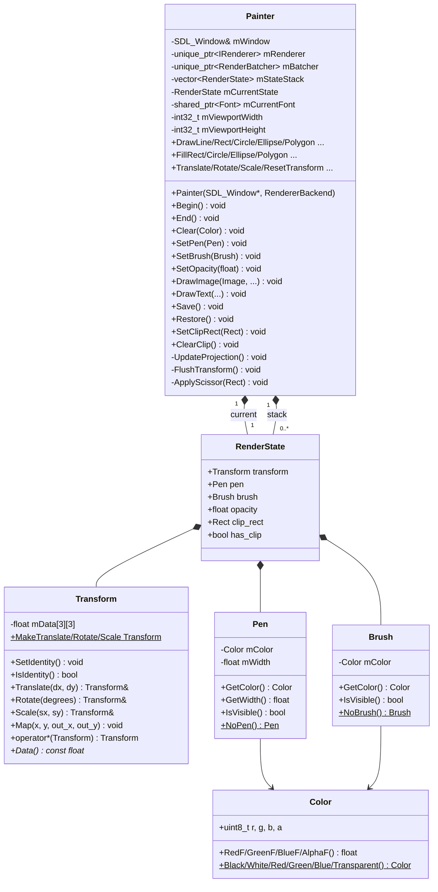
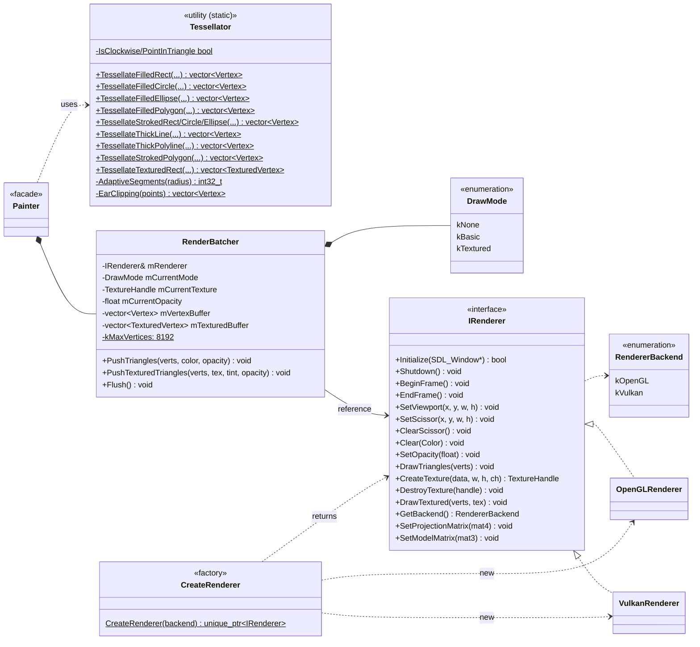
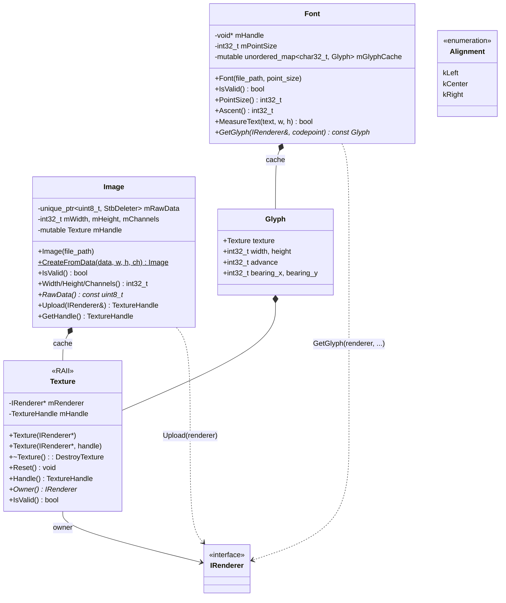
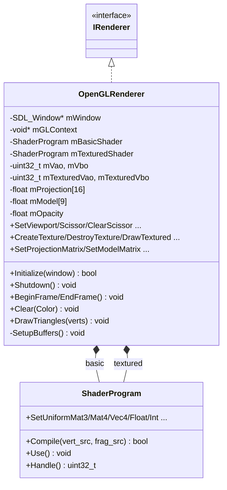
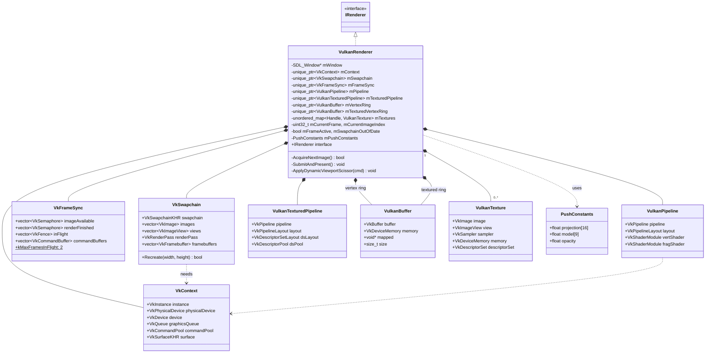
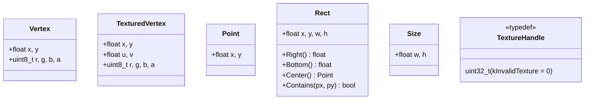

[Türkçe sürüm](../sinif-diyagrami.md) | **English**

# SDLPainter — Class Diagrams

This document gives SDLPainter's **class structure** in Mermaid `classDiagram`
notation. The diagrams are split into parts because a single graph quickly
becomes unreadable; each part focuses on a different concept.

---

## 1. Core Classes — Painter and Its Context

The three basic compositions around `Painter`: the style types (`Pen`/`Brush`),
the transform stack (`RenderState` + `Transform`), and the render pipeline
(`Tessellator` + `RenderBatcher` + `IRenderer`).

**Relationship notes**

- `Painter *-- RenderState`: Composition. `mCurrentState` is the active state,
  `mStateStack` is the stack that grows and shrinks with `Save()`/`Restore()`.
- `static` factory methods (`NoPen`, `Black`, `MakeTranslate`) are marked with `$`.

---

## 2. Render Pipeline — Tessellator, RenderBatcher, IRenderer

**Key point:** `Painter` does not call `IRenderer` **directly**; all drawing goes
through `RenderBatcher`. Only non-batch operations such as `Begin()`, `End()`,
`Clear()`, `SetViewport()`, `SetScissor()` go straight to `IRenderer`.

---

## 3. Image and Font Types

**Notes**

- `Texture` is a pure RAII wrapper; non-copyable, movable. Its destructor calls
  `DestroyTexture` through the renderer that owns it.
- `Image::Upload` is idempotent: the second call returns the existing handle
  (lazy upload + cache).
- On a glyph cache miss, `Font::GetGlyph` renders the glyph with SDL_ttf and
  uploads it into a texture; later calls return it from the cache.

---

## 4. OpenGL Backend Classes

The OpenGL backend uses only three external pieces: `ShaderProgram` (GLSL
program wrapper), GLAD (function loader, not a class), and the VAO/VBO handles.

---

## 5. Vulkan Backend Classes

The Vulkan backend is far more layered than OpenGL because pipelines,
descriptors, the swapchain and sync objects all have to be managed separately.

**Design decision:** All Vulkan resources are managed with `unique_ptr`; the
destructor order prevents incorrect resource destruction. `VkContext` is the
longest-lived object and is destroyed last.

---

## 6. Data Types Summary (POD/Value)

These types carry **value semantics**: copyable, small and meaningful on their
own. `Vertex` and `TexturedVertex` are the structures sent to the GPU; since
their layout is critical they must be changed carefully (they have to match the
shader attribute offsets).

---

## 7. Relationship Types Glossary

| Symbol | Meaning | Example |
|--------|-------|-------|
| `*--` | **Composition** — the member is destroyed when the owner is | `Painter *-- RenderBatcher` |
| `o--` | **Aggregation** — shared ownership | (not used) |
| `-->` | **Direct use** — pointer/reference | `RenderBatcher --> IRenderer` |
| `..>` | **Dependency** — short-lived use, forgotten on return | `Painter ..> Tessellator` |
| `<\|--` | **Inheritance** | (not used apart from interfaces) |
| `<\|..` | **Interface realization** | `IRenderer <\|.. OpenGLRenderer` |

Mermaid's `<<interface>>`, `<<enumeration>>`, `<<utility (static)>>`,
`<<RAII>>`, `<<facade>>`, `<<factory>>`, `<<typedef>>` stereotypes are used to
show the **character** of a class at a glance.
