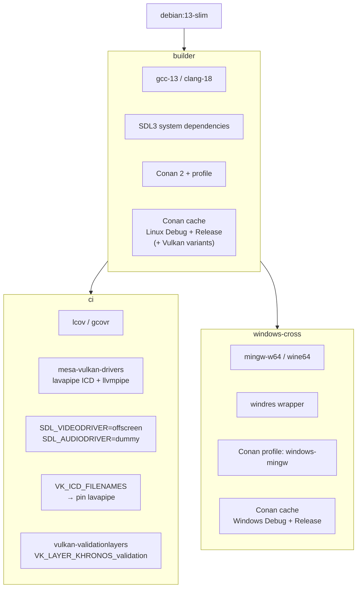
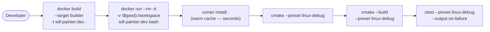
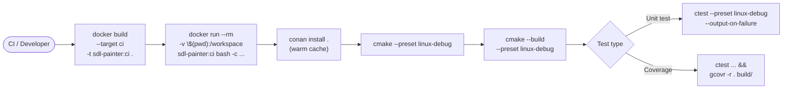
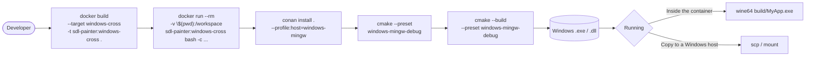
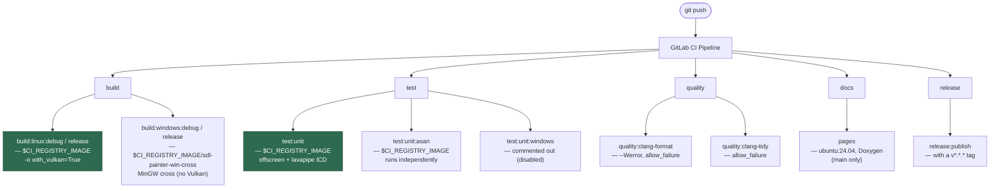
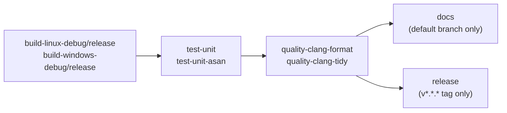

[Türkçe sürüm](../docker.md) | **English**

# Docker Stages — User Guide

On my **[Yazılımperver'in Dünyası](https://www.yazilimperver.net)** site I share
practical examples of using various technologies as much as I can, and this page
was written in the same spirit. You do not need to follow these steps to use
SDLPainter, but I think they will be useful for building and publishing your own
images.

## Image Hierarchy



---

## Local Development Flows

### builder — Linux development environment



```powershell
docker build --target builder -t sdl-painter:dev .
docker run --rm -it -v "${PWD}:/workspace" sdl-painter:dev bash

# Inside the container — conan install cannot be skipped: the /workspace mount
# shadows the build/ output in the image. Since the cache (~/.conan2) is warm in
# the image, this step takes seconds and no package is rebuilt.
conan install . --output-folder=build/linux-debug/generators --build=missing \
  -s build_type=Debug -s compiler=gcc -s compiler.version=13 -s compiler.libcxx=libstdc++11
cmake --preset linux-debug
cmake --build --preset linux-debug
```

---

### ci — Headless tests and code coverage



```powershell
docker build --target ci -t sdl-painter:ci .

# Debug test
docker run --rm -v "${PWD}:/workspace" sdl-painter:ci bash -c `
  "conan install . --output-folder=build/linux-debug/generators --build=missing -s build_type=Debug -s compiler=gcc -s compiler.version=13 -s compiler.libcxx=libstdc++11 && cmake --preset linux-debug && cmake --build --preset linux-debug && ctest --preset linux-debug --output-on-failure"

# Release test
docker run --rm -v "${PWD}:/workspace" sdl-painter:ci bash -c `
  "conan install . --output-folder=build/linux-release/generators --build=missing -s build_type=Release -s compiler=gcc -s compiler.version=13 -s compiler.libcxx=libstdc++11 && cmake --preset linux-release && cmake --build --preset linux-release && ctest --preset linux-release --output-on-failure"

# Build + test with Vulkan (headless with lavapipe)
docker run --rm -v "${PWD}:/workspace" sdl-painter:ci bash -c `
  "conan install . --output-folder=build/linux-release/generators --build=missing -s build_type=Release -s compiler=gcc -s compiler.version=13 -s compiler.libcxx=libstdc++11 -o '&:with_vulkan=True' && cmake --preset linux-release && cmake --build --preset linux-release && ctest --preset linux-release --output-on-failure"
```

---

### windows-cross — Windows cross-compile (Linux host)



```powershell
docker build --target windows-cross -t sdl-painter:windows-cross .

docker run --rm -v "${PWD}:/workspace" sdl-painter:windows-cross bash -c `
  "conan install . --output-folder=build/windows-mingw-debug/generators --build=missing -s build_type=Debug --profile:build=default --profile:host=windows-mingw && cmake --preset windows-mingw-debug && cmake --build --preset windows-mingw-debug"
```

---

## GitLab CI/CD Integration

The pipeline uses the images built from this repo's `Dockerfile` and pushed to
the GitLab Container Registry **directly**. There is **no** separate
`.conan_base` template or tool installation in `before_script` — the tools come
ready in the image.

| Job | Image | Source |
|---|---|---|
| `build:linux:*`, `test:unit*`, `quality:*` | `$CI_REGISTRY_IMAGE` | `Dockerfile` `ci` / `builder` target |
| `build:windows:*` | `$CI_REGISTRY_IMAGE/sdl-painter-win-cross` | `Dockerfile` `windows-cross` target (Linux + MinGW) |
| `pages` | `ubuntu:24.04` | Needs no Conan/CMake, only Doxygen |
| `release:publish` | `release-cli` | Runs on a `v*.*.*` tag |



> **Note:** The `build:windows:*` jobs are **not** a SaaS Windows runner / MSVC —
> they use the MinGW cross-compile image (`sdl-painter-win-cross`) on a Linux
> runner, and Vulkan is not supported on this target (`conanfile.py configure()`
> turns it off automatically). For a native MSVC build the separate
> `Dockerfile.windows` image is used (see below).

---

## GitHub Actions Integration

The same pipeline was also moved to GitHub Actions (`.github/workflows/ci.yml`).
The Linux jobs again use the image built from this repo's `Dockerfile`; the
difference is that the image is pulled from **Docker Hub** instead of the GitLab
Container Registry (`yazilimperver/sdl-painter:ci-v1.1`).

| Job | Environment | Source |
|---|---|---|
| `build-linux-*`, `test-unit*`, `quality-*` | `container: yazilimperver/sdl-painter:ci-v1.1` | `Dockerfile` `ci` target → Docker Hub |
| `build-windows-*` | `windows-latest` runner (**no** container) | Native MSVC + `actions/cache` |
| `docs` | `ubuntu-latest`, Doxygen via apt | Output is an artifact only (no Pages publish) |
| `release` | `ubuntu-latest`, `softprops/action-gh-release` | On a `v*.*.*` tag, notes from `CHANGELOG.md` |



Where it diverges from GitLab:

- **Windows strategy:** Native MSVC instead of MinGW cross-compile.
  `ilammy/msvc-dev-cmd` sets up the MSVC environment and Conan is installed with
  `pip`. Since there is no custom image, the Conan cache is stored with
  `actions/cache`, keyed on `hashFiles('conanfile.py')` — the cache is refreshed
  automatically when the dependencies change.
- **Image versioning:** The Docker Hub tag is versioned (`ci-v1.1`).
  When `conanfile.py` changes, a new tag must be pushed and the image reference
  in the workflow updated.
- **DAG difference:** In GitLab `test:unit:asan` and `quality:clang-format` run
  independently at the start of the pipeline with `needs: []`; in the GitHub
  workflow the jobs are chained with `needs` (build → test → quality →
  docs/release).
- **Concurrency:** On back-to-back pushes the older workflow run is cancelled
  automatically; tag pipelines are exempt from this cancellation.

---

## Dockerfile.windows — Native MSVC Image

The Windows counterpart of the Linux `Dockerfile`; a standalone, single-OS image:
VS Build Tools 17 (VS 2022) + standalone CMake + Python + Conan 2, and a Conan
cache pre-warmed with MSVC (Vulkan included). The Linux Conan steps do not run in
this image; they stay in the Linux `Dockerfile`.

```powershell
# Build — Docker must be in Windows containers mode. --network nat is REQUIRED:
# otherwise the conan steps cannot resolve DNS ("getaddrinfo failed").
docker build --network nat -f Dockerfile.windows -t sdl-painter-windows:latest .

# For a first check, without the Vulkan pre-cache (much faster):
docker build --network nat -f Dockerfile.windows `
  --build-arg WITH_VULKAN_PRECACHE=false -t sdl-painter-windows:latest .

# Native MSVC + Vulkan: build + tests:
docker run --rm --network nat --dns 8.8.8.8 -v ${PWD}:C:\workspace --entrypoint cmd `
  sdl-painter-windows:latest /S /C "call C:\BuildTools\VC\Auxiliary\Build\vcvars64.bat && cd /d C:\workspace && conan install . --output-folder=build/windows-release/generators --build=missing -s build_type=Release -s compiler.cppstd=17 -o ^&:with_vulkan=True && cmake --preset windows-release && cmake --build --preset windows-release && ctest --preset windows-release --output-on-failure"
```

> **WARNING:** Do **not push** this MSVC image to the `sdl-painter-win-cross` tag
> used in CI — that tag is the Linux + MinGW image; if it is replaced with MSVC,
> the `build:windows:*` jobs (Linux runner) break. Its place: local native MSVC
> build/test or an optional self-hosted Windows Docker runner (with a separate
> tag). For details see the "CI status" note inside `Dockerfile.windows`.

---

## Images Published on Docker Hub

Ready-made builds of all images are published
[on Docker Hub](https://hub.docker.com/r/yazilimperver/sdl-painter/tags) — they
can be pulled directly instead of building the image locally (which takes long,
especially because of the Conan pre-warming):

| Tag | Dockerfile target | Size (compressed) | Description |
|---|---|---|---|
| `ci-v1.1` | `Dockerfile` → `ci` | ~2.2 GB | Versioned tag used by the GitHub Actions Linux jobs |
| `ci` | `Dockerfile` → `ci` | ~2.2 GB | Unversioned tracking tag — points to the latest ci image |
| `windows-cross-v1.0` | `Dockerfile` → `windows-cross` | ~3.5 GB | Linux + MinGW-w64 cross-compile (Linux container) |
| `windows-v1.0` | `Dockerfile.windows` → `windows-msvc` | ~7.9 GB | Native MSVC + Vulkan (**Windows container** — requires Windows containers mode) |

```powershell
# Pull the ready-made image instead of building locally
docker pull yazilimperver/sdl-painter:ci-v1.1

# The commands from the ci flow above work the same way:
docker run --rm -v "${PWD}:/workspace" yazilimperver/sdl-painter:ci-v1.1 bash -c `
  "conan install . --output-folder=build/linux-debug/generators --build=missing -s build_type=Debug -s compiler=gcc -s compiler.version=13 -s compiler.libcxx=libstdc++11 && cmake --preset linux-debug && cmake --build --preset linux-debug && ctest --preset linux-debug --output-on-failure"
```

> **Versioning:** When `conanfile.py` or a Dockerfile changes, a new versioned tag
> (`ci-v1.1` etc.) is pushed and the image reference in the GitHub workflow is
> updated. Versioned tags are treated as immutable; the `ci` tracking tag, on the
> other hand, is moved to the latest image on every release. The GitLab side uses
> the same images from its own Container Registry (`$CI_REGISTRY_IMAGE`).

---

## Quick Reference

| File / Target | Image tag | Use |
|---|---|---|
| `Dockerfile` → `builder` | `sdl-painter:dev` | Local Linux development |
| `Dockerfile` → `ci` | `sdl-painter:ci` | Headless tests, code coverage, Vulkan (lavapipe) |
| `Dockerfile` → `ci` | `$CI_REGISTRY_IMAGE` | GitLab CI Linux jobs |
| `Dockerfile` → `ci` | `yazilimperver/sdl-painter:ci-v1.1` (Docker Hub) | GitHub Actions Linux jobs |
| `Dockerfile` → `windows-cross` | `sdl-painter:windows-cross` / `$CI_REGISTRY_IMAGE/sdl-painter-win-cross` / `yazilimperver/sdl-painter:windows-cross-v1.0` (Docker Hub) | Windows cross-compile (MinGW, no Vulkan) |
| `Dockerfile.windows` → `windows-msvc` | `sdl-painter-windows:latest` / `yazilimperver/sdl-painter:windows-v1.0` (Docker Hub) | Local native MSVC build + test (with Vulkan) |
