[Türkçe sürüm](../akislar.md) | **English**

# SDLPainter — Flow Diagrams

In this document I have tried to describe SDLPainter's **runtime behavior** with
sequence and flow diagrams. For the static structure see the
[Class Diagram](class-diagram.md); for the layer context see the
[Architecture Overview](architecture.md).

---

## 1. Frame Lifecycle

The flow Painter and the renderer follow in a typical game loop iteration:

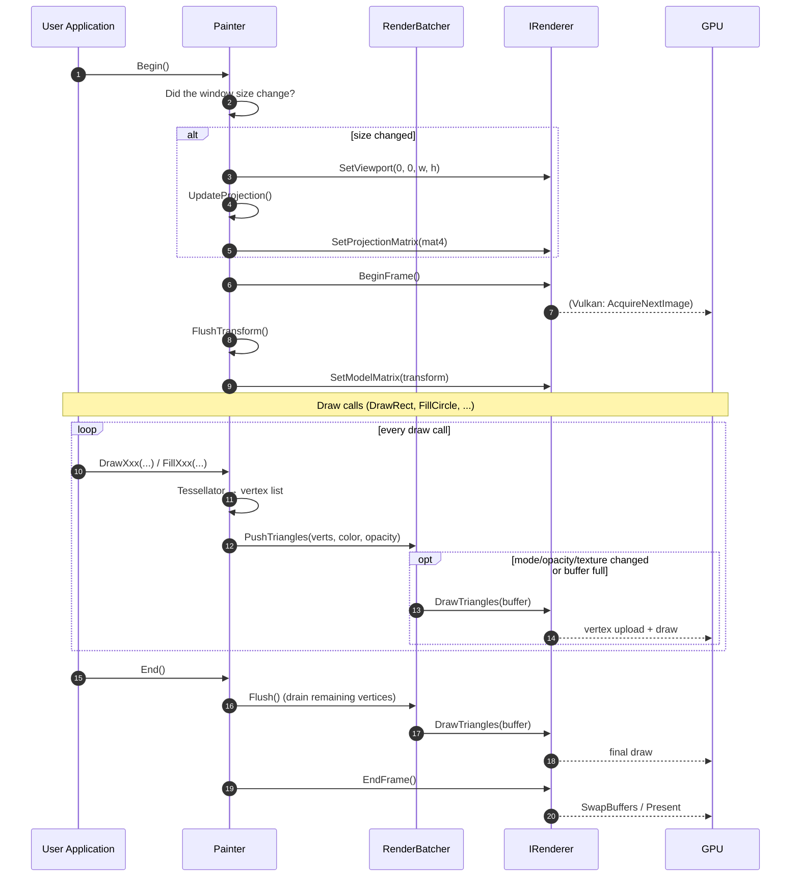

**Important contracts**

- Draw calls must be **between Begin/End**; otherwise the tessellator produces
  vertices but they pile up in the batcher and the frame boundary is undefined.
- `End()` calls a **guaranteed `Flush()`**; no vertices are lost when the
  application shuts down.
- A window size change is checked at the start of every `Begin()`; no manual
  callback is needed.

---

## 2. A Single `DrawRect` Call in Detail

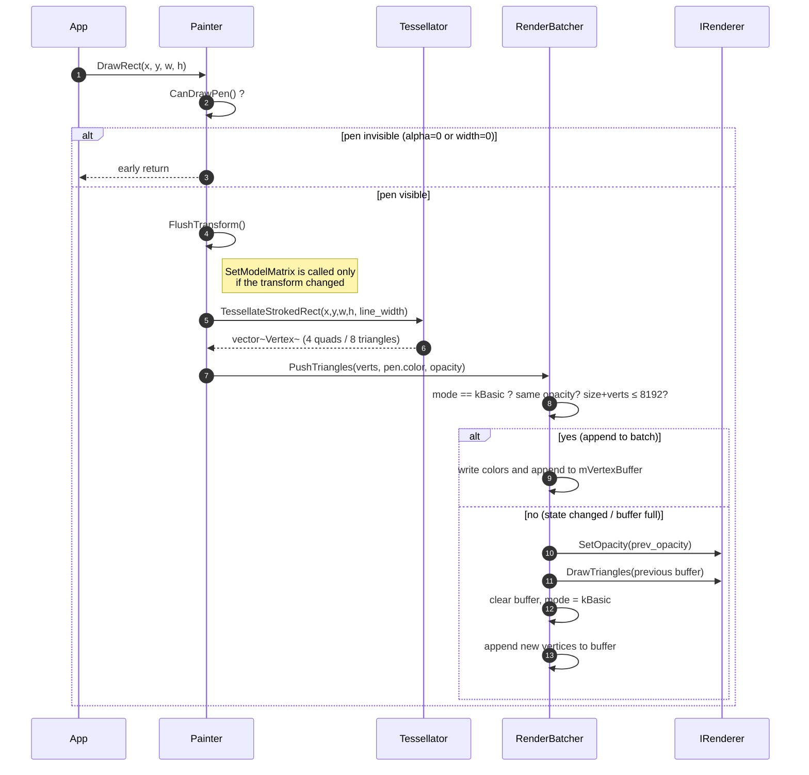

**Key point:** Tessellator calls are **stateless**, so they are always
deterministic. This is why measuring and testing need no GPU (with a mock
IRenderer).

---

## 3. Render Batcher Flow

`RenderBatcher`'s internal state machine and the conditions that trigger
`Flush()`:

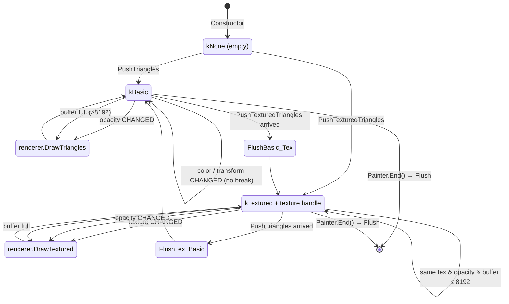

### Flush Trigger Conditions (Table)

| Transition | Cause | Result |
|-------|-------|-------|
| kBasic → kBasic | Same opacity, buffer < 8192 | **NO flush**, vertices are appended |
| kBasic → kBasic | Opacity changed | **Flush** + a new batch starts |
| kBasic → kBasic | Buffer would exceed 8192 vertices | **Flush** + new batch |
| kBasic → kTextured | Draw mode changed | **Flush** + a textured batch starts |
| kTextured → kTextured | Texture changed | **Flush** + new texture batch |
| Painter.SetClipRect / ClearClip | Scissor GPU state changed | **Flush** + new scissor |
| Painter.Restore() | If the clip state **actually** changed | **Flush** + scissor restored |
| Painter.End() | End of frame | **Flush** (whatever is left) |
| Painter.Clear() | Screen clear | **Flush** first, then Clear |

**Things that DO NOT trigger a flush** (often confused):

| Operation | Why it does not break the batch |
|-------|----------------------|
| `SetPen` / `SetBrush` | Color is carried in the `Vertex`, not a uniform |
| `Translate` / `Rotate` / `Scale` / `ResetTransform` | The transform is applied to the vertices on the CPU inside `RenderBatcher`; the model matrix is always identity |
| `Save()` | Nothing that is saved is GPU state |
| `Restore()` — if the clip is the same | Only a clip change requires a flush |
| `SetOpacity` — to the same value | `SameOpacity()` tolerance (1/512) |

**Practical effect:** 2000 `FillRect`s in different colors, each with its own
`Translate`/`Rotate` → **2 draw calls** (12 000 vertices, split in two only
because of the 8192 ceiling).

This table is a measurement, not a guess: for per-scenario draw call and timing
data see **[`examples/benchmarks/README.md`](../../examples/benchmarks/README.md)**.
The same counters can be read at runtime with `Painter::GetFrameStats()`, and in
`Application`-based programs in the on-screen overlay toggled with **F1**.

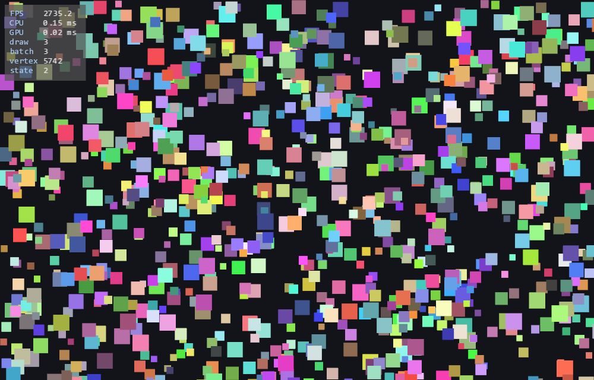

---

## 4. Transform Stack — `Save` / `Restore` Logic

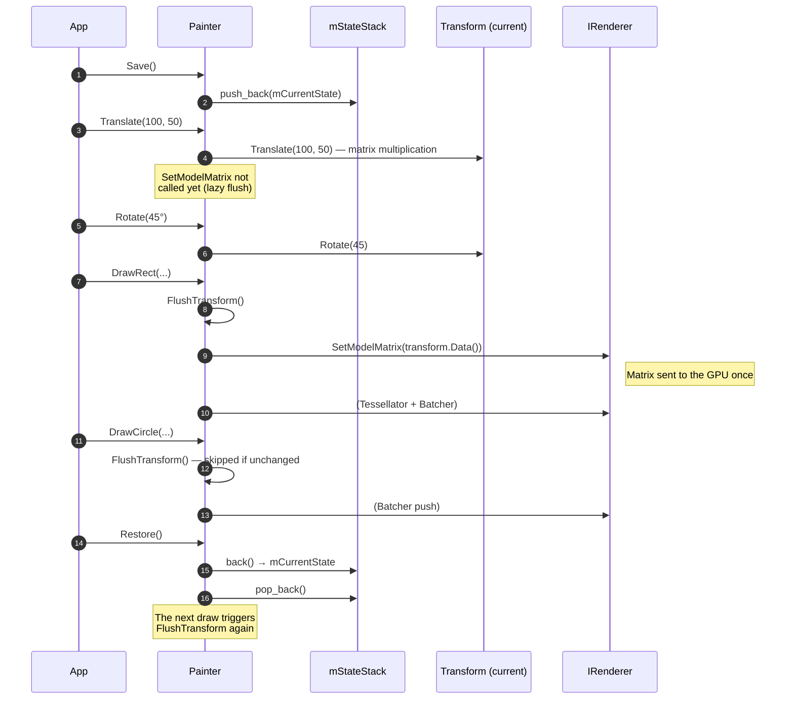

**What does RenderState carry?** → `transform`, `pen`, `brush`, `opacity`,
`clip_rect`, `has_clip`. `Save()` takes a **copy of all of them**;
`Restore()` restores them all.

### Nested Save/Restore

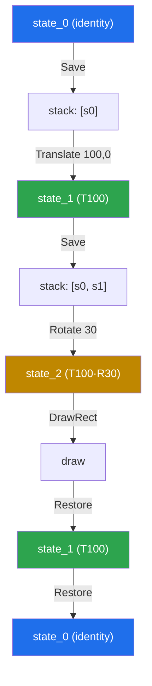

---

## 5. Texture Upload (Image → GPU)

`Image` uses a lazy upload + cache strategy. It uploads on the first call and
returns the existing handle afterwards.

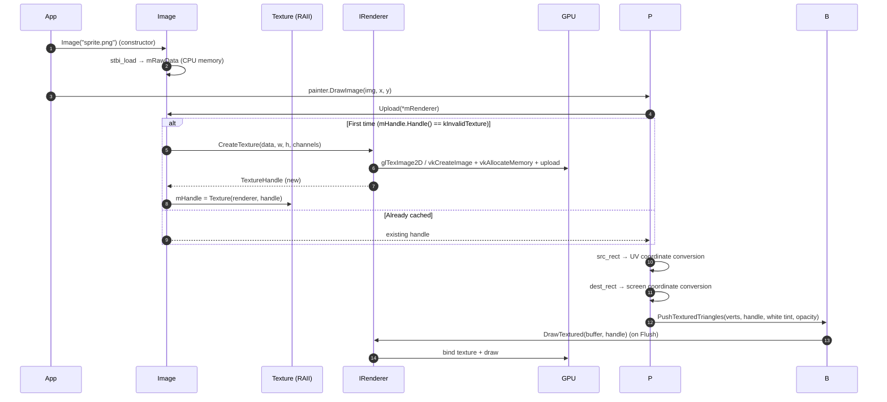

### Image / Texture Lifecycle

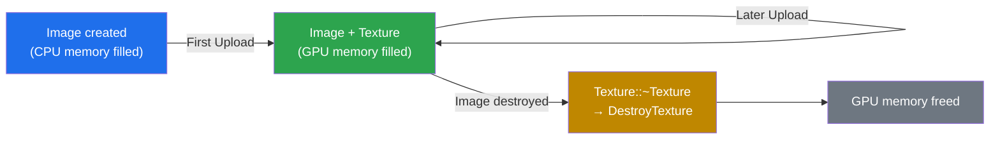

**RAII guarantee:** The `Texture` class is non-copyable and movable. Its
destructor calls `DestroyTexture` → a texture leak is impossible.

---

## 6. Text Rendering (Phase 4) — Glyph Cache

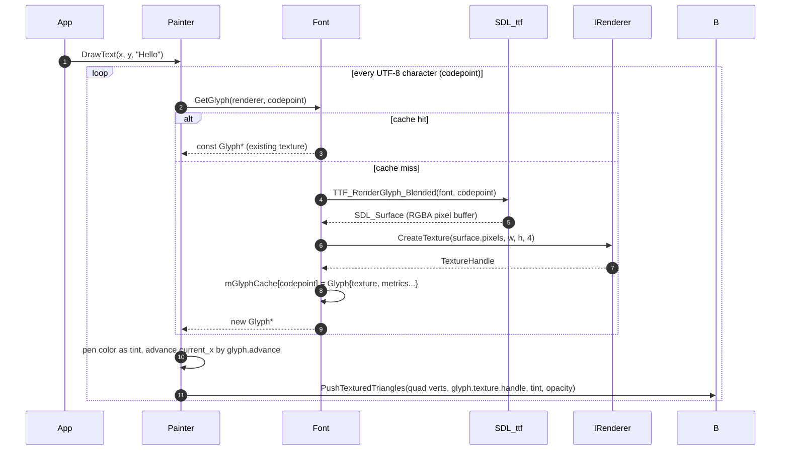

**Optimization:** The glyph cache works per UTF-8 codepoint. Turkish characters
and emoji cost something on their first render and are free afterwards.

---

## 7. Vulkan Frame Flow (Phase 5)

In OpenGL `BeginFrame`/`EndFrame` are almost trivial; in Vulkan there is
swapchain management, sync objects and out-of-date handling.

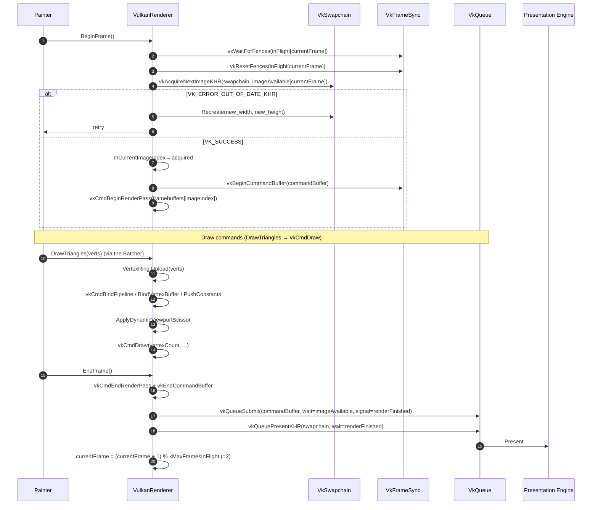

**Out-of-date handling:** When the window is resized, the swapchain becomes
invalid. `AcquireNextImage` or `QueuePresent` returns `OUT_OF_DATE`;
`VulkanRenderer` rebuilds the swapchain with `Recreate`. Painter is not aware of
this detail.

---

## 8. Backend Selection (Factory)

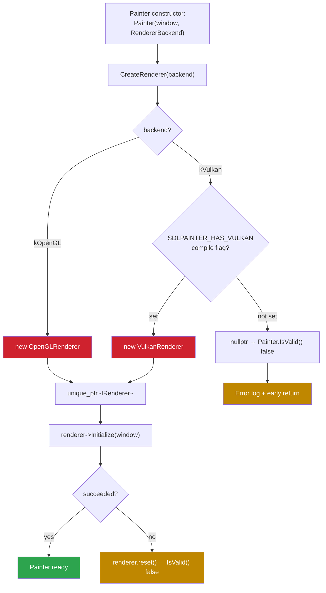

**Contract:** The Painter constructor can fail; **the user must check with
`painter.IsValid()`**. No exception is thrown (for deterministic errors on the
C++ side).

---

## 9. Tessellator Internal Flows

### 9.1 Adaptive Circle Segment Count

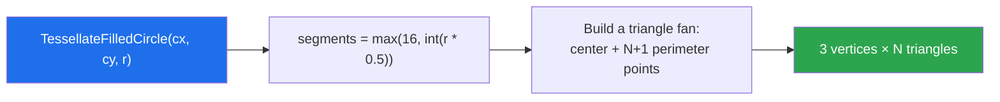

| Radius | Segments | Triangles | Vertices |
|---------|---------|-------|--------|
| 8 px    | 16      | 16    | 48     |
| 50 px   | 25      | 25    | 75     |
| 200 px  | 100     | 100   | 300    |
| 1000 px | 500     | 500   | 1500   |

### 9.2 Concave Polygon — Ear Clipping

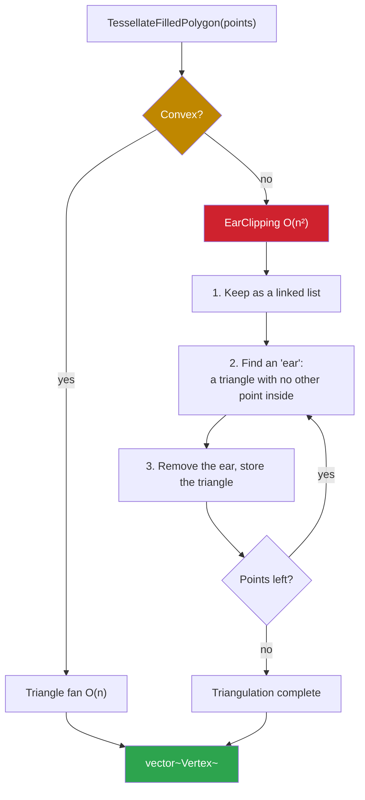

### 9.3 Thick Line (no `glLineWidth`)

Under an orthographic projection this approach gives pixel-consistent results on
every platform; `glLineWidth`, on the other hand, has an upper limit that varies
by driver.

---

## 10. Misuse Scenarios

| Mistake | Effect | Safeguard |
|------|------|-------|
| `DrawRect` without calling `Begin()` | Piles up in the buffer, frame boundary breaks | Assertion in the API (development) |
| Shutting down without calling `End()` | The last batch is not flushed, the last frame is broken | Painter destructor → Shutdown |
| `Pen({0,0,0,0}, 5.0f)` | `IsVisible()` false → drawing is skipped | Early return, no GPU load |
| Not checking `painter.IsValid()` | Null deref if renderer init failed | The demos check it mandatorily |
| `Upload`ing the same `Image` in multiple Painters | A separate texture per renderer | An Image should be bound to one renderer |
| Forgetting `Restore` after `Save` | `mStateStack` leaks | An RAII guard helper is suggested (v2) |
